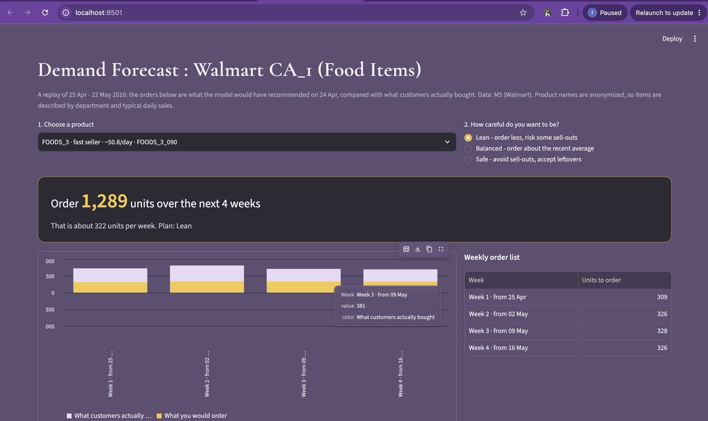
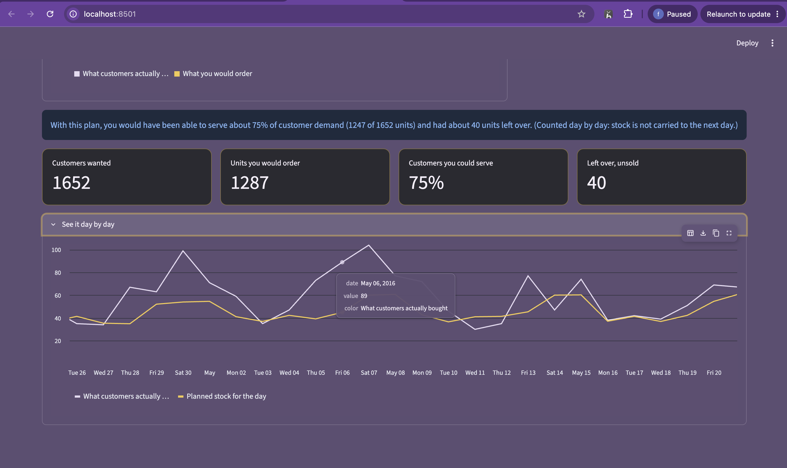
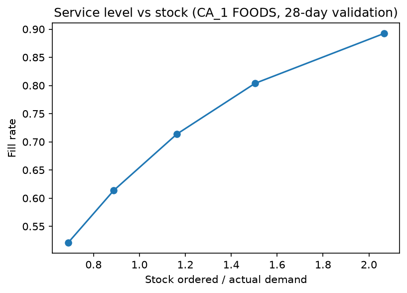

# Demand Forecasting on Walmart M5 Data

Forecasts 28 days of daily demand for about 1,400 food products in one Walmart store, then turns the forecasts into weekly order quantities and shows the trade-off between running out of stock and having leftovers.

**Live demo:** _add your Streamlit link here after deploying_






## The problem

A store has to decide how many units of each product to order for the next four weeks.

- Order too little and shelves run empty, so customers leave without buying (lost sales).
- Order too much and stock sits unsold (waste and cost).

This project learns from about five years of daily sales, predicts the next 28 days for every item, and lets a user choose how careful to be: lean, balanced or safe.

## Data

- **M5 Forecasting dataset (Walmart)**, downloaded from Zenodo: https://zenodo.org/records/12636070 (CC-BY 4.0).
- **Subset used:** store `CA_1` (California store 1), category `FOODS`: 1,437 items, daily sales from 2011-01-29 to 2016-05-22, plus calendar (events, SNAP benefit days) and weekly price tables.
- Product names are anonymized in M5, so items are described by department and typical daily sales.
- Rows from before an item was first on sale (no price recorded) were removed. That took the share of zero-sales rows from 57% to 46.8%, so the remaining zeros are real "on the shelf but nobody bought it" days.

## Approach

**Target:** units sold per item per day.

**Validation:** time-based splits, never random. The model trains on data up to 24 Apr 2016 and is tested on the next 28 days (25 Apr - 22 May 2016). The same test was repeated on three earlier 28-day windows.

**Features (9):** lagged and rolling sales, day of week, month, SNAP day, price, Christmas flag, event flag. Every sales-based feature uses data at least 28 days old, because a forecaster standing at the start of the window cannot see sales from inside it. This prevents data leakage.

**Models compared:**
1. Flat baseline: each item's average over the last 28 days
2. Weekday baseline: last 28 days' average per item and weekday
3. Hybrid baseline: weekday average for fast items, flat average for the rest
4. LightGBM, default loss (squared error)
5. LightGBM, L1 loss (absolute error)
6. LightGBM quantile models (50th to 90th percentile), used for stocking plans

**Metric:** WAPE (total absolute error divided by total actual sales). Unlike MAPE, it works when many days have zero sales.

## Results

### Overall accuracy (latest window, 25 Apr - 22 May 2016)

| Model | WAPE (lower is better) |
|---|---|
| Flat 28-day average | 0.674 |
| Weekday average | 0.685 |
| Hybrid baseline | 0.666 |
| LightGBM, default loss | 0.676 |
| **LightGBM, L1 loss** | **0.647** |

### Does it hold on earlier windows?

| Window start | Flat | LightGBM default | LightGBM L1 |
|---|---|---|---|
| 2016-02-01 | 0.689 | 0.724 | **0.670** |
| 2016-02-29 | 0.696 | 0.712 | **0.665** |
| 2016-03-28 | 0.684 | 0.697 | **0.646** |
| 2016-04-25 | 0.674 | 0.676 | **0.647** |

The L1 model beat the flat baseline in all four windows, by roughly 3-5%. The default model never did.

### Accuracy by item speed (latest window)

Items grouped by their average daily sales over the last 28 training days.

| Segment | Items | Share of sales | Flat | LightGBM L1 |
|---|---|---|---|---|
| Very slow (<0.5/day) | 318 | 6.9% | 1.109 | 1.006 |
| Slow (0.5-2) | 723 | 25.5% | 0.941 | 0.901 |
| Medium (2-10) | 360 | 46.2% | 0.610 | 0.599 |
| Fast (>10) | 36 | 21.4% | 0.353 | 0.335 |

### From forecast to ordering decision

Customers wanted about 90,800 units in the 28 days. Stocking to a higher quantile of the forecast buys more service but needs more stock:

| Plan | Fill rate | Stock ordered / demand | Leftover units |
|---|---|---|---|
| 50th percentile (lean) | 52% | 0.69x | 15,281 |
| 60th percentile | 61% | 0.89x | 24,938 |
| 70th percentile | 71% | 1.16x | 40,811 |
| 80th percentile | 80% | 1.50x | 63,617 |
| 90th percentile (safe) | 89% | 2.07x | 106,573 |



The curve flattens: each extra point of fill rate costs more stock than the last. How careful to be is a business decision that depends on margin and shelf life, not a modeling question.

## Key findings

- **Demand has a strong weekly cycle.** Sunday and Saturday are the busiest days; Sunday is roughly 55% above Wednesday.
- **SNAP benefit days lift sales** by about 12% per item-day.
- **Events matter by name, not as a group.** Average sales per item-day were about 1.5 on Thanksgiving and 3.1 on Labor Day and Super Bowl days, against about 2.4 on a normal day. Demand also rises in the days before Labor Day.
- **The store closes on Christmas.** All five lowest-sales days are 25 December, with zero sales.
- **Slow items are not predictable day by day.** For the slowest 318 items, even the best model is no better than forecasting zero (WAPE about 1.0).
- **A forecast can be right in total and still fail.** One slow item had a total forecast of 24 units against 23 sold, yet only 43% of demand could be served and 14 units were left over, because demand comes in lumps and stock is decided daily.
- **The L1 loss helped because it matches the metric.** WAPE rewards the median, the default loss targets the mean, and for items that are mostly zero those differ a lot.

## Limitations

- One store and one category, and the baselines and models are only tested on four 28-day windows.
- The L1 objective and the hybrid baseline rule were chosen after looking at the latest window. The three earlier windows act as a check, but there is no fully untouched test set.
- Sales are not the same as demand. Zero-sales runs can be stockouts, and the model treats them as low demand.
- The ordering analysis is simplified: each day is judged separately, unsold stock is written off, and there are no costs, margins, delivery times or expiry dates.
- The dashboard is a replay of a past period, not a live system.
- The model does not know which item it is predicting; it only sees that item's past sales level.
- No hyperparameter tuning was done.

## Run it

**Dashboard only (no data download needed):**
```bash
git clone <your-repo-url>
cd Demand-forecasting
python3 -m venv venv
source venv/bin/activate
pip install -r requirements.txt
streamlit run app.py
```

**Reproduce the analysis:**
1. Download the M5 files from Zenodo (link above) and unzip them into a folder named `m5-forecasting-accuracy/` in the project root.
2. Open `notebook/01_explore.ipynb` and run the cells in order.

On a Mac, LightGBM needs OpenMP: run `brew install libomp` if the import fails.

## Project structure

```
Demand-forecasting/
├── app.py                  # Streamlit ordering assistant
├── requirements.txt
├── .streamlit/config.toml  # dashboard theme
├── notebook/
│   └── 01_explore.ipynb    # data prep, features, models, validation
└── results/
    ├── val_predictions.csv # forecasts used by the dashboard
    ├── service_curve.csv
    ├── service_curve.png
    └── dashboard.png
```

## Tech

Python, pandas, NumPy, LightGBM, scikit-learn, Matplotlib, Streamlit

## Author

Faizabi Shaikh
